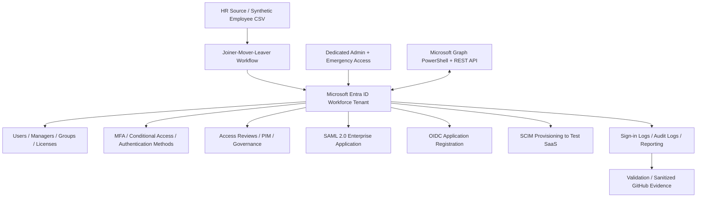

# Enterprise Microsoft Entra ID IAM Lab

> **START HERE — implementation workbook and GitHub README.** This guide is designed to be followed in order while you build the lab and take screenshots. **Status: not yet executed.** Check boxes only after testing. Okta is deliberately out of scope.

## How to work through this guide

1. Complete the **Manual Steps** of the current phase first. Do not run write commands before verifying your pilot configuration.
2. Run **PowerShell** examples only after replacing placeholders and checking the required delegated permissions. Code snippets labeled *pattern* or *example* are not turnkey bulk-production scripts.
3. Where included, use Graph REST calls to verify API behavior; follow pagination for inventory requests.
4. Capture screenshots **as you go** using the evidence checkpoint at the end of each phase. Redact email domains if desired, IDs, secrets, tokens, authentication codes and sensitive audit content.
5. Execute the validation, deliberately test one safe failure where appropriate, and document the actual outcome.
6. Mark a phase complete only when its evidence and test results are in GitHub. Do not send screenshots to the assistant unless you are stuck.


## Executable lab files and operating sequence

This README is the entry point to a **multi-file GitHub repository**. Copy the entire folder, not only `README.md`, because the executable scripts and templates are linked below.

| Artifact | Purpose |
|---|---|
| [`scripts/Invoke-Joiner.ps1`](scripts/Invoke-Joiner.ps1) | One-user approved joiner creation and static group mapping |
| [`scripts/Invoke-Mover.ps1`](scripts/Invoke-Mover.ps1) | Department/manager changes and reconciliation of managed static groups |
| [`scripts/Invoke-Leaver.ps1`](scripts/Invoke-Leaver.ps1) | Disable sign-in, revoke Entra sessions and optionally remove direct static security groups |
| [`scripts/Test-IdentityBaseline.ps1`](scripts/Test-IdentityBaseline.ps1) | Check expected identities, departments and job titles; export CSV results |
| [`data/group-map.csv`](data/group-map.csv) | Explicit approved department-to-security-group mapping |
| [`docs/application-intake-template.md`](docs/application-intake-template.md) | Record actual SAML, OIDC and SCIM application-specific settings |
| [`docs/rollback-runbook.md`](docs/rollback-runbook.md) | Recovery and post-change validation |
| [`docs/progress-log.md`](docs/progress-log.md) | Evidence and phase sign-off |

### PowerShell preflight (before every write operation)

```powershell
$TenantId = '<YOUR-TENANT-GUID>'
Connect-MgGraph -TenantId $TenantId -Scopes 'User.ReadWrite.All','Group.ReadWrite.All','Directory.Read.All'
if ((Get-MgContext).TenantId -ne $TenantId) { throw 'Unexpected tenant' }
Get-MgContext | Format-List TenantId,Account,Scopes
```

Use `-WhatIf` first, inspect target users and group mappings, then run only against **synthetic pilot identities**. `-WhatIf` previews the top-level action; it does not emulate the complete downstream execution or prove a rollback will work. Scripts are lab reference implementations and must be validated against your installed Graph SDK version and tenant before being trusted.

### Mover example (Phase 13)

```powershell
./scripts/Invoke-Mover.ps1 -TenantId $TenantId `
  -UserPrincipalName 'pilot@yourtenant.onmicrosoft.com' `
  -NewDepartment 'IT' -NewJobTitle 'IT Support Analyst' `
  -GroupMapPath './data/group-map.csv' -WhatIf
```

Remove `-WhatIf` after approval. Verify direct application assignments, dynamic membership processing, licensing, and downstream SCIM changes separately. The script only reconciles **groups explicitly listed in the mapping CSV**; it does not remove every possible entitlement.

### Leaver example (Phase 14)

```powershell
./scripts/Invoke-Leaver.ps1 -TenantId $TenantId `
  -UserPrincipalName 'pilot@yourtenant.onmicrosoft.com' `
  -ApprovedChangeId 'LAB-LEAVER-001' -WhatIf
```

After review, execute against the synthetic pilot. The optional `-RemoveDirectSecurityGroups` flag removes direct memberships in static security groups; it cannot guarantee downstream session revocation, SCIM deactivation, license recovery, or removal of every direct application assignment. Verify these separately. Never automatically re-enable a terminated user as a rollback.

### Inventory validation (Phases 3 and 24)

```powershell
./scripts/Test-IdentityBaseline.ps1 -TenantId $TenantId `
  -CsvPath './data/employees.csv' `
  -OutputPath './reports/identity-validation.csv'
```

The script exits nonzero if a listed user is missing or their department/job title differs. It does not test authentication, license assignment, manager relationships, or app provisioning; those require the separate acceptance tests in Phase 24.

### Selecting the three application targets

Before Phases 19–21, select and document **one compatible test target for each protocol**. A generic sandbox is not proof of compatibility. Confirm current vendor documentation, trial access, supported flow, endpoint requirements, and licensing. Suggested candidates to evaluate are a SAML-capable enterprise gallery application with a free test tenant; a Microsoft identity platform web-app sample for OIDC authorization code + PKCE; and a SCIM 2.0 sandbox with supported create/update/deactivate operations. Complete [`docs/application-intake-template.md`](docs/application-intake-template.md) for each. Do not invent ACS URLs, redirect URIs, tokens, SCIM schemas, or successful outcomes.

### Licensing and feature gates

| Feature | Required gate before testing |
|---|---|
| Dynamic groups / Conditional Access | Confirm applicable Entra ID P1 entitlement and tenant availability |
| PIM | Confirm appropriate Entra ID P2 or qualifying governance entitlement |
| Access reviews | Confirm the applicable Entra ID Governance / premium entitlement for the review type |
| SAML / OIDC | Confirm actual application and permitted tenant registration |
| SCIM | Confirm target supports Entra-compatible SCIM 2.0 provisioning and deactivation |

If unavailable, record `BLOCKED — LICENSING` or `BLOCKED — TARGET APP`, not `PASS`.

### Evidence naming convention

`evidence/phase-01/P01-01-description.png`, `evidence/phase-01/P01-02-description.png`, etc. Use `evidence/phase-02/` through `evidence/phase-25/` for later phases. Do not upload screenshots showing passwords, access tokens, secret values, private keys, TAP codes, or unredacted personal data.

### Per-phase implementation record (copy into `docs/progress-log.md`)

```text
Phase:
Date (UTC):
Tenant / environment:
Prerequisites and licenses checked:
Manual steps completed:
PowerShell commands run:
Graph REST requests run:
Expected result:
Actual result:
Positive test:
Negative test:
Troubleshooting / changes:
Rollback test (where safe):
Evidence files:
Status: NOT STARTED / IN PROGRESS / BLOCKED / PASSED
```

### Stop conditions

- If a required premium feature is unavailable, mark it **BLOCKED — LICENSING**, document the exact limitation, and proceed only with safe independent phases.
- If a write operation targets the wrong tenant or user, **stop** and verify `Get-MgContext`, object IDs, and change scope.
- If an access policy risks locking out all admins, do not enable it; validate emergency access and report-only behavior first.
- If a test app does not support the required protocol, choose a documented compatible sandbox rather than claiming the integration passed.

---


> **Project status:** Planned / in progress. Configuration, automation, and test results must be verified before marking any phase complete.

Hands-on enterprise Identity and Access Management (IAM) project simulating a 50-person organization. The implementation covers Microsoft Entra ID tenant setup, identity lifecycle management, authentication, Conditional Access, application federation, SCIM provisioning, governance, privileged access, automation, monitoring, and operational documentation.

## Project Overview

This project builds a **new Microsoft Entra ID workforce tenant** for the fictional **AccessShield Technologies** organization. It follows a manual-first implementation methodology, then uses **Microsoft Graph PowerShell SDK** for supported automation and **Microsoft Graph REST API** for selected integrations. **Python is not required.**

The 25 phases are intended to demonstrate reproducible IAM engineering, not merely screenshots of settings. Every phase includes validation and evidence requirements. Some advanced features require Entra ID P1/P2, Entra ID Governance, compatible SaaS applications, or other licensing.

## Business Scenario

AccessShield Technologies has 50 synthetic employees across Executive Leadership, IT, HR, Finance, Sales, and Operations. The company needs centralized identity administration, department-based access, secure authentication, automated joiner/mover/leaver (JML) workflows, privileged access controls, SaaS SSO, and auditable access governance.

**Objectives**

- Provision and manage 50 **fictional** identities and their managers.
- Enforce least privilege with group-based access and role separation.
- Secure authentication using MFA and Conditional Access where licensed.
- Automate JML operations and validate access removal.
- Integrate SAML, OIDC, and SCIM-capable test applications.
- Record sign-in, audit, access-review, and automation evidence.
- Produce reusable PowerShell scripts and deployment/runbooks.
- Prepare a separate future Okta project and an Okta–Entra integration project.

## Architecture Diagram



### Authentication and Authorization Flow

1. A synthetic employee identity is created from approved HR data.
2. Department, manager, and role attributes are populated.
3. Group memberships determine application eligibility.
4. Authentication is evaluated against enabled MFA and Conditional Access controls.
5. The target application trusts Entra ID through SAML or OIDC, or receives provisioning through SCIM.
6. Sign-in, provisioning, and access changes are reviewed through logs and tests.

**IAM principle:** Authentication verifies identity; authorization determines permitted access; provisioning creates or removes downstream accounts; governance verifies access remains appropriate.

## IAM Concepts Demonstrated

| Concept | Implementation |
|---|---|
| Identity provider | Microsoft Entra ID |
| Directory management | Users, managers, custom attributes, groups |
| RBAC | Group-based application entitlements and scoped administrative roles |
| Authentication | MFA, authentication methods, Temporary Access Pass |
| Conditional access | Risk-aware or contextual access controls, subject to licensing |
| Federation | SAML 2.0 and OpenID Connect |
| Provisioning | CSV, Microsoft Graph, and SCIM |
| Lifecycle management | Joiner, mover, leaver |
| Governance | Access reviews, SoD checks, orphan-account review |
| Privileged access | Separate admin identities, emergency access, PIM where licensed |
| Automation | Microsoft Graph PowerShell SDK and selected REST calls |
| Auditability | Sign-in logs, audit logs, test results, runbooks |

## Technologies Used

- Microsoft Entra admin center and Azure portal
- Microsoft Entra ID workforce tenant
- Microsoft Graph PowerShell SDK
- Microsoft Graph REST API / Graph Explorer or PowerShell `Invoke-MgGraphRequest`
- PowerShell 7 (recommended)
- CSV and JSON
- Test SAML and OIDC applications
- SCIM-compatible test application or endpoint
- Git and GitHub Markdown / Mermaid

## Prerequisites and Licensing

1. A Microsoft account or eligible Azure/Microsoft 365 subscription capable of creating a **new workforce tenant**. Microsoft's tenant-creation eligibility and portal navigation can change; follow the current [Microsoft tenant creation guide](https://learn.microsoft.com/en-us/entra/fundamentals/create-new-tenant).
2. A dedicated lab environment with **no real employee data**.
3. An administrator account protected with strong authentication and a documented recovery process.
4. PowerShell 7, optional for manual-only tasks; Microsoft Graph PowerShell for automation.
5. Entra ID P1 for most Conditional Access features; P2 or relevant Governance licensing for certain risk-based controls, PIM, and access reviews. Check current feature-specific requirements before each phase.
6. A compatible test app and any required SaaS licensing for SAML/SCIM exercises.
7. **Never publish passwords, tokens, client secrets, certificate private keys, tenant-specific confidential data, or unredacted logs.**

> **Safety:** Do not disable Security Defaults merely to enable Conditional Access until a tested replacement MFA policy and emergency-access strategy are in place. Test policy changes with pilot accounts and report-only mode when supported.

## Implementation Methodology

| Approach | Recommendation | Reason |
|---|---|---|
| **Manual configuration** | Essential | Demonstrates hands-on Entra ID administration and troubleshooting |
| **Microsoft Graph PowerShell SDK** | Strongly recommended | Automates users, groups, licensing, and lifecycle operations |
| **Microsoft Graph REST API** | Add selectively | Demonstrates direct API integration and troubleshooting |

**For each phase:** Manual steps → PowerShell where supported → selected REST API where useful → validation → troubleshooting → sanitized screenshot evidence.

### Common PowerShell Preparation

```powershell
# Run once in a PowerShell session. Install from a trusted PSGallery source.
Install-Module Microsoft.Graph -Scope CurrentUser
Import-Module Microsoft.Graph

# Start with read-only delegated scopes; request additional permissions only for specific phases.
Connect-MgGraph -Scopes 'Organization.Read.All','User.Read.All','Group.Read.All','AuditLog.Read.All'
Get-MgContext | Select-Object TenantId,Account,Scopes
Get-MgOrganization | Select-Object Id,DisplayName,VerifiedDomains
```

**Permissions:** Microsoft Graph scopes do not replace Entra administrative roles. Mutating commands require both appropriate Graph permissions and sufficient directory roles. Request only the permissions needed for each script; do not use blanket admin permissions by default.

---

# Implementation — All 25 Phases

## Phase 1 — Create a New Workforce Tenant and Establish Security Baseline

**Objective:** Create a separate AccessShield Technologies tenant and document its initial state.

### Manual Steps

1. Open [Azure portal](https://portal.azure.com) and sign in with an eligible account.
2. Search for **Microsoft Entra ID**; find **Manage tenants → Create**, if available.
3. Select a **Microsoft Entra ID workforce tenant**, not an external-customer tenant.
4. Set organization name to `AccessShield Technologies`, choose an available `onmicrosoft.com` domain (proposed: `accessshield-iam-lab.onmicrosoft.com`), and select the appropriate region.
5. Review and create. If tenant creation is blocked, use Microsoft's current supported signup/eligibility route rather than assuming an API workaround.
6. Switch to the new directory and record its tenant ID, primary domain, and display name.
7. Verify the creator's administrator access. Plan a dedicated daily-use identity and separate privileged admin identity.
8. Review **Protection → Authentication methods**, **Properties**, **Roles and administrators**, and **Licenses**. Keep Security Defaults enabled unless a tested, licensed Conditional Access replacement is ready.
9. Establish secure recovery/emergency access procedures; do not expose recovery credentials in GitHub.
10. Record screenshots of the new tenant overview and sanitized licensing inventory.

### PowerShell — Read-Only Verification

```powershell
Connect-MgGraph -Scopes 'Organization.Read.All','Directory.Read.All'
$org = Get-MgOrganization
$org | Select-Object Id,DisplayName,VerifiedDomains | Format-List
Get-MgSubscribedSku | Select-Object SkuPartNumber,ConsumedUnits
```

**Automation limitation:** Creating the workforce tenant itself is not a standard supported Microsoft Graph PowerShell/REST provisioning workflow; complete creation using Microsoft's supported portal or signup experience.

**Validation:** Confirm correct tenant ID, domain, admin access, baseline authentication settings, and license inventory.

**Evidence:** `screenshots/01-tenant-overview.png`, `screenshots/01-licensing.png`.


### Field Guide — Phase 01 Evidence and Exit Gate

**Screenshot checkpoints:** Capture the following in `evidence/phase-01/` with filenames beginning `P01-01-`, `P01-02-`, etc.: Tenant overview; tenant ID/domain; admin role inventory; authentication baseline.

**Before continuing:**

- [ ] Required permissions and licenses checked
- [ ] Manual configuration completed in the correct tenant
- [ ] Automation or API examples executed where applicable (or marked not applicable)
- [ ] Expected and actual results recorded
- [ ] One positive test and a safe negative test recorded where applicable
- [ ] Configuration-specific recovery/rollback documented
- [ ] Screenshots sanitized and committed to GitHub
- [ ] Phase status updated in `docs/progress-log.md`

**If blocked:** Record the exact error message, UTC time, correlation ID (when available), and what you tried. Share a screenshot only if troubleshooting is needed.

## Phase 2 — Design the 50-Employee Identity Dataset

**Objective:** Build a fictional HR source of truth before provisioning.

### Manual Steps

1. Define six departments: Executive Leadership, IT, HR, Finance, Sales, Operations.
2. Create a synthetic roster with 50 unique employees and fictional names.
3. Include `EmployeeId`, `DisplayName`, `GivenName`, `Surname`, `UserPrincipalName`, `Department`, `JobTitle`, `ManagerEmployeeId`, `UsageLocation`, and `EmploymentType`.
4. Define manager relationships and flag contractor/test accounts explicitly.
5. Validate UPN uniqueness, required fields, manager references, and allowed departments.
6. Save as `data/employees.synthetic.csv` (never export real HR data).

### PowerShell — Validate CSV

```powershell
$rows = Import-Csv './data/employees.synthetic.csv'
if ($rows.Count -ne 50) { throw "Expected 50 synthetic employees; found $($rows.Count)." }
if (($rows.UserPrincipalName | Sort-Object -Unique).Count -ne $rows.Count) {
    throw 'Duplicate UPN detected.'
}
$required = 'EmployeeId','DisplayName','UserPrincipalName','Department','UsageLocation'
foreach ($r in $rows) {
    foreach ($field in $required) {
        if ([string]::IsNullOrWhiteSpace($r.$field)) { throw "Missing $field for $($r.EmployeeId)" }
    }
}
'CSV validation passed.'
```

**Validation:** Exactly 50 rows; no duplicate UPNs; managers reference known employee IDs.

**Evidence:** `screenshots/02-synthetic-dataset.png` (redact any unintended personal data).


### Field Guide — Phase 02 Evidence and Exit Gate

**Screenshot checkpoints:** Capture the following in `evidence/phase-02/` with filenames beginning `P02-01-`, `P02-02-`, etc.: CSV department totals; unique employee IDs/UPNs; manager-reference check.

**Before continuing:**

- [ ] Required permissions and licenses checked
- [ ] Manual configuration completed in the correct tenant
- [ ] Automation or API examples executed where applicable (or marked not applicable)
- [ ] Expected and actual results recorded
- [ ] One positive test and a safe negative test recorded where applicable
- [ ] Configuration-specific recovery/rollback documented
- [ ] Screenshots sanitized and committed to GitHub
- [ ] Phase status updated in `docs/progress-log.md`

**If blocked:** Record the exact error message, UTC time, correlation ID (when available), and what you tried. Share a screenshot only if troubleshooting is needed.

## Phase 3 — Provision Users in Microsoft Entra ID

**Objective:** Create test identities with accurate profile attributes.

### Manual Steps

1. In **Entra admin center → Entra ID → Users → New user → Create new user**, create one pilot employee.
2. Set display name, UPN, department, job title, and usage location.
3. Assign a temporary password through a secure channel and require a password change if appropriate.
4. Confirm the pilot user appears in the directory.
5. Provision the remaining fictional users with PowerShell in controlled batches.

### PowerShell — Example Pilot Provisioning

```powershell
Connect-MgGraph -Scopes 'User.ReadWrite.All'
$domain = 'YOUR-VERIFIED-DOMAIN.onmicrosoft.com'
$upn = "james.morgan@$domain"
# Use a secure, randomly generated temporary password. Never commit it to Git.
$secure = [System.Security.Cryptography.RandomNumberGenerator]::GetBytes(24)
$tempPassword = [Convert]::ToBase64String($secure) + 'aA1!'
$params = @{
    accountEnabled = $true
    displayName = 'James Morgan'
    mailNickname = 'james.morgan'
    userPrincipalName = $upn
    givenName = 'James'
    surname = 'Morgan'
    department = 'Sales'
    jobTitle = 'Sales Representative'
    usageLocation = 'US'
    passwordProfile = @{ password = $tempPassword; forceChangePasswordNextSignIn = $true }
}
New-MgUser -BodyParameter $params | Select-Object Id,DisplayName,UserPrincipalName
# Deliver the password securely; clear the session variable afterward.
Remove-Variable tempPassword,secure -ErrorAction SilentlyContinue
```

**Scale-up:** Extend the pilot script to import the validated CSV, check whether each UPN exists, and log outcomes without passwords. Avoid automatic duplicate creation on reruns.

**Validation:** Query all 50 synthetic accounts and verify profile fields and sign-in eligibility.

**Evidence:** `screenshots/03-user-provisioning.png`.


### Field Guide — Phase 03 Evidence and Exit Gate

**Screenshot checkpoints:** Capture the following in `evidence/phase-03/` with filenames beginning `P03-01-`, `P03-02-`, etc.: Pilot user creation; full user list; attribute validation; duplicate check.

**Before continuing:**

- [ ] Required permissions and licenses checked
- [ ] Manual configuration completed in the correct tenant
- [ ] Automation or API examples executed where applicable (or marked not applicable)
- [ ] Expected and actual results recorded
- [ ] One positive test and a safe negative test recorded where applicable
- [ ] Configuration-specific recovery/rollback documented
- [ ] Screenshots sanitized and committed to GitHub
- [ ] Phase status updated in `docs/progress-log.md`

**If blocked:** Record the exact error message, UTC time, correlation ID (when available), and what you tried. Share a screenshot only if troubleshooting is needed.

## Phase 4 — Configure Manager Relationships and Organizational Hierarchy

### Manual Steps

1. Open a test user's profile and locate **Manager**.
2. Assign the appropriate fictional manager based on the HR CSV.
3. Confirm the relationship in the user profile.
4. Repeat for pilot accounts, then automate the remaining assignments.

### PowerShell

```powershell
Connect-MgGraph -Scopes 'User.ReadWrite.All'
$employee = Get-MgUser -UserId 'james.morgan@YOUR-VERIFIED-DOMAIN.onmicrosoft.com'
$manager  = Get-MgUser -UserId 'alex.chen@YOUR-VERIFIED-DOMAIN.onmicrosoft.com'
Set-MgUserManagerByRef -UserId $employee.Id -BodyParameter @{
    '@odata.id' = "https://graph.microsoft.com/v1.0/users/$($manager.Id)"
}
Get-MgUserManager -UserId $employee.Id
```

**Validation:** Manager relationships match the roster; no circular reporting chains.

**Evidence:** `screenshots/04-manager-hierarchy.png`.


### Field Guide — Phase 04 Evidence and Exit Gate

**Screenshot checkpoints:** Capture the following in `evidence/phase-04/` with filenames beginning `P04-01-`, `P04-02-`, etc.: User manager properties; reporting hierarchy; manager Graph verification.

**Before continuing:**

- [ ] Required permissions and licenses checked
- [ ] Manual configuration completed in the correct tenant
- [ ] Automation or API examples executed where applicable (or marked not applicable)
- [ ] Expected and actual results recorded
- [ ] One positive test and a safe negative test recorded where applicable
- [ ] Configuration-specific recovery/rollback documented
- [ ] Screenshots sanitized and committed to GitHub
- [ ] Phase status updated in `docs/progress-log.md`

**If blocked:** Record the exact error message, UTC time, correlation ID (when available), and what you tried. Share a screenshot only if troubleshooting is needed.

## Phase 5 — Create Department, Application, and Security Groups

### Manual Steps

1. Open **Entra ID → Groups → All groups → New group**.
2. Create department security groups such as `SG-Dept-HR`, `SG-Dept-Finance`, and `SG-Dept-IT`.
3. Create application groups such as `SG-App-CRM-Users` and `SG-App-Finance-Users`.
4. Document group owners, descriptions, and approval authority.
5. Add pilot users and verify memberships.

### PowerShell

```powershell
Connect-MgGraph -Scopes 'Group.ReadWrite.All'
New-MgGroup -DisplayName 'SG-Dept-HR' `
  -Description 'Synthetic HR department access group' `
  -MailEnabled:$false -MailNickname 'sg-depthr' -SecurityEnabled:$true
```

**Validation:** Group names are unique, ownership is documented, and pilot users have expected memberships.

**Evidence:** `screenshots/05-security-groups.png`.


### Field Guide — Phase 05 Evidence and Exit Gate

**Screenshot checkpoints:** Capture the following in `evidence/phase-05/` with filenames beginning `P05-01-`, `P05-02-`, etc.: Department groups; group ownership; member assignments.

**Before continuing:**

- [ ] Required permissions and licenses checked
- [ ] Manual configuration completed in the correct tenant
- [ ] Automation or API examples executed where applicable (or marked not applicable)
- [ ] Expected and actual results recorded
- [ ] One positive test and a safe negative test recorded where applicable
- [ ] Configuration-specific recovery/rollback documented
- [ ] Screenshots sanitized and committed to GitHub
- [ ] Phase status updated in `docs/progress-log.md`

**If blocked:** Record the exact error message, UTC time, correlation ID (when available), and what you tried. Share a screenshot only if troubleshooting is needed.

## Phase 6 — Configure Dynamic Membership Rules

### Manual Steps

1. Confirm licensing supports dynamic membership groups.
2. Create a dynamic security group for one department.
3. Use a rule such as `(user.department -eq "Finance")`.
4. Wait for membership evaluation and verify eligible users.
5. Change a synthetic test user's department and confirm membership updates.

### PowerShell

```powershell
Connect-MgGraph -Scopes 'Group.ReadWrite.All'
New-MgGroup -DisplayName 'DG-Dept-Finance' `
  -MailEnabled:$false -MailNickname 'dg-deptfinance' -SecurityEnabled:$true `
  -GroupTypes @('DynamicMembership') `
  -MembershipRule '(user.department -eq "Finance")' `
  -MembershipRuleProcessingState 'On'
```

**Validation:** Only matching synthetic users join; membership changes after department updates.

**Evidence:** `screenshots/06-dynamic-rule.png`, `screenshots/06-membership-test.png`.


### Field Guide — Phase 06 Evidence and Exit Gate

**Screenshot checkpoints:** Capture the following in `evidence/phase-06/` with filenames beginning `P06-01-`, `P06-02-`, etc.: Dynamic rule; membership processing state; IT and non-IT membership comparison.

**Before continuing:**

- [ ] Required permissions and licenses checked
- [ ] Manual configuration completed in the correct tenant
- [ ] Automation or API examples executed where applicable (or marked not applicable)
- [ ] Expected and actual results recorded
- [ ] One positive test and a safe negative test recorded where applicable
- [ ] Configuration-specific recovery/rollback documented
- [ ] Screenshots sanitized and committed to GitHub
- [ ] Phase status updated in `docs/progress-log.md`

**If blocked:** Record the exact error message, UTC time, correlation ID (when available), and what you tried. Share a screenshot only if troubleshooting is needed.

## Phase 7 — Implement Role-Based Access Control (RBAC)

### Manual Steps

1. Create `docs/rbac-matrix.md` mapping business roles to groups and application access.
2. Separate business application access from Entra administrative roles.
3. Assign application access to groups, not individuals, wherever supported.
4. For administrative work, assign the narrowest built-in Entra role required.
5. Validate that Sales users cannot access Finance-only applications.

### PowerShell — Read-Only Role Inventory

```powershell
Connect-MgGraph -Scopes 'RoleManagement.Read.Directory'
Get-MgRoleManagementDirectoryRoleAssignment | Select-Object PrincipalId,RoleDefinitionId,DirectoryScopeId
```

**Validation:** Approved role-to-access matrix matches effective entitlements.

**Evidence:** `screenshots/07-rbac-validation.png`.


### Field Guide — Phase 07 Evidence and Exit Gate

**Screenshot checkpoints:** Capture the following in `evidence/phase-07/` with filenames beginning `P07-01-`, `P07-02-`, etc.: RBAC matrix; enterprise application assignments; least-privilege check.

**Before continuing:**

- [ ] Required permissions and licenses checked
- [ ] Manual configuration completed in the correct tenant
- [ ] Automation or API examples executed where applicable (or marked not applicable)
- [ ] Expected and actual results recorded
- [ ] One positive test and a safe negative test recorded where applicable
- [ ] Configuration-specific recovery/rollback documented
- [ ] Screenshots sanitized and committed to GitHub
- [ ] Phase status updated in `docs/progress-log.md`

**If blocked:** Record the exact error message, UTC time, correlation ID (when available), and what you tried. Share a screenshot only if troubleshooting is needed.

## Phase 8 — Test Separation of Duties (SoD)

### Manual Steps

1. Define conflicting entitlements (for example, `Finance-Payment-Submitter` and `Finance-Payment-Approver`).
2. Create a controlled synthetic conflict in a test account only.
3. Identify the conflict through a group-membership review.
4. Remove the inappropriate entitlement and document approval/remediation.
5. Add a periodic conflict review to the governance runbook.

### PowerShell — Example Conflict Detection

```powershell
$submitters = @(Get-MgGroupMember -GroupId 'SUBMITTER-GROUP-ID' -All | Select-Object -ExpandProperty Id)
$approvers  = @(Get-MgGroupMember -GroupId 'APPROVER-GROUP-ID' -All | Select-Object -ExpandProperty Id)
$conflicts = $submitters | Where-Object { $_ -in $approvers }
$conflicts | ForEach-Object { "SoD conflict: $_" }
```

**Validation:** The conflict is detected and no longer appears after remediation.

**Evidence:** `screenshots/08-sod-conflict.png`.


### Field Guide — Phase 08 Evidence and Exit Gate

**Screenshot checkpoints:** Capture the following in `evidence/phase-08/` with filenames beginning `P08-01-`, `P08-02-`, etc.: Conflicting groups; conflict detection output; remediation result.

**Before continuing:**

- [ ] Required permissions and licenses checked
- [ ] Manual configuration completed in the correct tenant
- [ ] Automation or API examples executed where applicable (or marked not applicable)
- [ ] Expected and actual results recorded
- [ ] One positive test and a safe negative test recorded where applicable
- [ ] Configuration-specific recovery/rollback documented
- [ ] Screenshots sanitized and committed to GitHub
- [ ] Phase status updated in `docs/progress-log.md`

**If blocked:** Record the exact error message, UTC time, correlation ID (when available), and what you tried. Share a screenshot only if troubleshooting is needed.

## Phase 9 — Review and Assign Licenses

### Manual Steps

1. Open **Entra ID → Licenses → All products** and review available subscriptions.
2. Record required features and the license assigned to each test user.
3. Prefer group-based licensing where supported and appropriate.
4. Confirm license assignment does not exceed available seats.
5. Review service-plan errors and usage-location requirements.

### PowerShell — Inventory

```powershell
Connect-MgGraph -Scopes 'Organization.Read.All','Directory.Read.All'
Get-MgSubscribedSku | Select-Object SkuId,SkuPartNumber,ConsumedUnits
```

**Validation:** Target users have required licenses and no unresolved assignment errors.

**Evidence:** `screenshots/09-license-inventory.png`.


### Field Guide — Phase 09 Evidence and Exit Gate

**Screenshot checkpoints:** Capture the following in `evidence/phase-09/` with filenames beginning `P09-01-`, `P09-02-`, etc.: Subscribed SKUs; usage locations; pilot license assignment.

**Before continuing:**

- [ ] Required permissions and licenses checked
- [ ] Manual configuration completed in the correct tenant
- [ ] Automation or API examples executed where applicable (or marked not applicable)
- [ ] Expected and actual results recorded
- [ ] One positive test and a safe negative test recorded where applicable
- [ ] Configuration-specific recovery/rollback documented
- [ ] Screenshots sanitized and committed to GitHub
- [ ] Phase status updated in `docs/progress-log.md`

**If blocked:** Record the exact error message, UTC time, correlation ID (when available), and what you tried. Share a screenshot only if troubleshooting is needed.

## Phase 10 — Configure MFA and Temporary Access Pass (TAP)

### Manual Steps

1. Review the tenant's existing authentication-methods policy and Security Defaults.
2. Enable appropriate methods for a pilot group, such as Microsoft Authenticator.
3. Enroll a synthetic pilot user and complete an MFA challenge.
4. If available, enable Temporary Access Pass for a tightly scoped pilot group.
5. Issue a short-lived TAP only through an authorized administrative workflow.
6. Confirm successful registration and remove/expire temporary credentials.

### PowerShell — Read-Only Method Inspection

```powershell
Connect-MgGraph -Scopes 'UserAuthenticationMethod.Read.All'
Get-MgUserAuthenticationMethod -UserId 'PILOT-USER-ID'
```

**Validation:** Pilot authentication method is registered and MFA is successfully enforced by the active tenant policy.

**Evidence:** `screenshots/10-auth-methods.png` (never capture TAP values or recovery codes).


### Field Guide — Phase 10 Evidence and Exit Gate

**Screenshot checkpoints:** Capture the following in `evidence/phase-10/` with filenames beginning `P10-01-`, `P10-02-`, etc.: Authentication method policy; test-user method registration; MFA test outcome (no codes).

**Before continuing:**

- [ ] Required permissions and licenses checked
- [ ] Manual configuration completed in the correct tenant
- [ ] Automation or API examples executed where applicable (or marked not applicable)
- [ ] Expected and actual results recorded
- [ ] One positive test and a safe negative test recorded where applicable
- [ ] Configuration-specific recovery/rollback documented
- [ ] Screenshots sanitized and committed to GitHub
- [ ] Phase status updated in `docs/progress-log.md`

**If blocked:** Record the exact error message, UTC time, correlation ID (when available), and what you tried. Share a screenshot only if troubleshooting is needed.

## Phase 11 — Design and Pilot Conditional Access

### Manual Steps

1. Confirm Entra ID P1 or other applicable licensing.
2. Document existing Security Defaults and emergency-access design before changing policies.
3. Create a **pilot** Conditional Access policy targeting a small test group.
4. Exclude designated emergency-access accounts from policies where appropriate.
5. Configure **Require MFA** for a pilot cloud application.
6. Use **Report-only** mode where supported and inspect sign-in results.
7. Plan separate policies for legacy authentication and privileged accounts; avoid enabling broad blocking rules before validation.
8. Transition to enabled enforcement only after confirming recovery paths and impact.

### PowerShell — Read-Only Policy Inventory

```powershell
Connect-MgGraph -Scopes 'Policy.Read.All'
Get-MgIdentityConditionalAccessPolicy | Select-Object DisplayName,State,Id
```

**Validation:** Pilot users are evaluated as expected; excluded emergency accounts remain usable.

**Evidence:** `screenshots/11-ca-report-only.png`, `screenshots/11-ca-signin-result.png`.


### Field Guide — Phase 11 Evidence and Exit Gate

**Screenshot checkpoints:** Capture the following in `evidence/phase-11/` with filenames beginning `P11-01-`, `P11-02-`, etc.: Report-only policy; sign-in policy evaluation; approved enforcement outcome.

**Before continuing:**

- [ ] Required permissions and licenses checked
- [ ] Manual configuration completed in the correct tenant
- [ ] Automation or API examples executed where applicable (or marked not applicable)
- [ ] Expected and actual results recorded
- [ ] One positive test and a safe negative test recorded where applicable
- [ ] Configuration-specific recovery/rollback documented
- [ ] Screenshots sanitized and committed to GitHub
- [ ] Phase status updated in `docs/progress-log.md`

**If blocked:** Record the exact error message, UTC time, correlation ID (when available), and what you tried. Share a screenshot only if troubleshooting is needed.

## Phase 12 — Automate Joiner Onboarding

### Manual Steps

1. Define an approved joiner request with department, manager, start date, and access profile.
2. Create a synthetic new hire and assign a manager.
3. Apply department/application groups based on the RBAC matrix.
4. Assign required licenses and authentication enrollment instructions.
5. Validate that access is limited to the approved role.

### PowerShell — Executable Joiner Workflow

Use the included [`scripts/Invoke-Joiner.ps1`](scripts/Invoke-Joiner.ps1), not pseudocode. First create all approved groups from Phase 5 and save `data/employees.csv` with `DisplayName,UserPrincipalName,Department,JobTitle,UsageLocation,ManagerUPN`. Use `data/group-map.csv` to map departments to approved static security groups. **Never use actual employee data.**

```powershell
Connect-MgGraph -TenantId '<TENANT-ID>' -Scopes 'User.ReadWrite.All','Group.ReadWrite.All','Directory.Read.All'
Get-MgContext | Select-Object TenantId,Scopes

./scripts/Invoke-Joiner.ps1 -TenantId '<TENANT-ID>' `
  -CsvPath './data/employees.csv' `
  -UserPrincipalName 'newhire@yourtenant.onmicrosoft.com' `
  -GroupMapPath './data/group-map.csv' -WhatIf

# Remove -WhatIf only after reviewing the exact target, groups and approval.
```

The script creates **one** synthetic user per approved execution, assigns its manager and mapped static groups, and fails if the UPN already exists. It deliberately does **not** assign licenses or configure MFA; perform the licensed Phase 9 workflow and Phase 10 authentication enrollment separately. Record those as explicit completion gates.

**Validation:** New hire receives approved access, required MFA enrollment, and no extra entitlements.

**Evidence:** `evidence/phase-12/P12-01-joiner-created.png`, `P12-02-groups.png`, `P12-03-validation.png` (redacted).


### Field Guide — Phase 12 Evidence and Exit Gate

**Screenshot checkpoints:** Capture the following in `evidence/phase-12/` with filenames beginning `P12-01-`, `P12-02-`, etc.: New-hire request; identity creation; access verification and logs.

**Before continuing:**

- [ ] Required permissions and licenses checked
- [ ] Manual configuration completed in the correct tenant
- [ ] Automation or API examples executed where applicable (or marked not applicable)
- [ ] Expected and actual results recorded
- [ ] One positive test and a safe negative test recorded where applicable
- [ ] Configuration-specific recovery/rollback documented
- [ ] Screenshots sanitized and committed to GitHub
- [ ] Phase status updated in `docs/progress-log.md`

**If blocked:** Record the exact error message, UTC time, correlation ID (when available), and what you tried. Share a screenshot only if troubleshooting is needed.

## Phase 13 — Automate Mover Transitions

### Manual Steps

1. Select a synthetic user moving from Sales to Finance.
2. Record existing group and application entitlements.
3. Update department, job title, and manager.
4. Add approved Finance groups and **remove obsolete Sales entitlements**.
5. Inspect direct assignments that dynamic group changes may not remove.
6. Validate that no privilege creep remains.

### PowerShell — Attribute Update

```powershell
Connect-MgGraph -Scopes 'User.ReadWrite.All'
Update-MgUser -UserId 'MOVER-USER-ID' -Department 'Finance' -JobTitle 'Financial Analyst'
Get-MgUser -UserId 'MOVER-USER-ID' -Property Department,JobTitle | Select-Object Department,JobTitle
```

**Validation:** Former role access is revoked and new role access is present.

**Evidence:** `screenshots/13-before-after-access.png`.


### Field Guide — Phase 13 Evidence and Exit Gate

**Screenshot checkpoints:** Capture the following in `evidence/phase-13/` with filenames beginning `P13-01-`, `P13-02-`, etc.: Before/after group memberships; department and manager change; SoD retest.

**Before continuing:**

- [ ] Required permissions and licenses checked
- [ ] Manual configuration completed in the correct tenant
- [ ] Automation or API examples executed where applicable (or marked not applicable)
- [ ] Expected and actual results recorded
- [ ] One positive test and a safe negative test recorded where applicable
- [ ] Configuration-specific recovery/rollback documented
- [ ] Screenshots sanitized and committed to GitHub
- [ ] Phase status updated in `docs/progress-log.md`

**If blocked:** Record the exact error message, UTC time, correlation ID (when available), and what you tried. Share a screenshot only if troubleshooting is needed.

## Phase 14 — Execute Leaver Offboarding

### Manual Steps

1. Create an approved fictional termination event.
2. Block sign-in promptly according to the scenario.
3. Revoke active sessions and refresh tokens where supported.
4. Remove application and group assignments according to the retention policy.
5. Review licenses and downstream SCIM deprovisioning status.
6. Document data retention, ownership transfer, and account deletion timing separately.

### PowerShell — Pilot Account Only

```powershell
Connect-MgGraph -Scopes 'User.ReadWrite.All','User.RevokeSessions.All'
$userId = 'LEAVER-USER-ID'
Update-MgUser -UserId $userId -AccountEnabled:$false
Revoke-MgUserSignInSession -UserId $userId
# Group removal and license cleanup require separate approved, validated steps.
```

**Validation:** Sign-in is blocked; active sessions are revoked as supported; downstream entitlements are reviewed.

**Evidence:** `screenshots/14-leaver-validation.png`.


### Field Guide — Phase 14 Evidence and Exit Gate

**Screenshot checkpoints:** Capture the following in `evidence/phase-14/` with filenames beginning `P14-01-`, `P14-02-`, etc.: Disabled test identity; session revocation response; downstream access test.

**Before continuing:**

- [ ] Required permissions and licenses checked
- [ ] Manual configuration completed in the correct tenant
- [ ] Automation or API examples executed where applicable (or marked not applicable)
- [ ] Expected and actual results recorded
- [ ] One positive test and a safe negative test recorded where applicable
- [ ] Configuration-specific recovery/rollback documented
- [ ] Screenshots sanitized and committed to GitHub
- [ ] Phase status updated in `docs/progress-log.md`

**If blocked:** Record the exact error message, UTC time, correlation ID (when available), and what you tried. Share a screenshot only if troubleshooting is needed.

## Phase 15 — Conduct Access Reviews and Identify Orphaned Accounts

### Manual Steps

1. Verify whether access reviews are available under current licensing.
2. Select a pilot group or application for periodic review.
3. Define reviewer, review duration, and decision criteria.
4. Simulate approval and removal decisions with synthetic identities.
5. Identify accounts without valid managers, owners, or recent authorized activity.
6. Document remediation and retention decisions.

### PowerShell — Candidate Review Inventory

```powershell
Connect-MgGraph -Scopes 'User.Read.All'
Get-MgUser -All -Property Id,DisplayName,AccountEnabled,Department,EmployeeId |
  Select-Object Id,DisplayName,AccountEnabled,Department,EmployeeId |
  Export-Csv './reports/user-review-candidates.csv' -NoTypeInformation
```

**Validation:** Reviewer decisions and remediation actions are traceable; no unapproved account deletion.

**Evidence:** `screenshots/15-access-review.png`.


### Field Guide — Phase 15 Evidence and Exit Gate

**Screenshot checkpoints:** Capture the following in `evidence/phase-15/` with filenames beginning `P15-01-`, `P15-02-`, etc.: Access-review scope; reviewer decisions; remediation evidence.

**Before continuing:**

- [ ] Required permissions and licenses checked
- [ ] Manual configuration completed in the correct tenant
- [ ] Automation or API examples executed where applicable (or marked not applicable)
- [ ] Expected and actual results recorded
- [ ] One positive test and a safe negative test recorded where applicable
- [ ] Configuration-specific recovery/rollback documented
- [ ] Screenshots sanitized and committed to GitHub
- [ ] Phase status updated in `docs/progress-log.md`

**If blocked:** Record the exact error message, UTC time, correlation ID (when available), and what you tried. Share a screenshot only if troubleshooting is needed.

## Phase 16 — Secure Privileged Access and Evaluate PIM

### Manual Steps

1. Create separate admin and standard-user identities for privileged lab operators.
2. Assign least-privileged roles, such as User Administrator, only where needed.
3. Document emergency-access account ownership and recovery procedures.
4. If licensed, configure a pilot eligible role in Privileged Identity Management (PIM).
5. Require appropriate activation controls, justification, and audit review.
6. Validate role expiration and privilege removal.

### PowerShell — Privileged Assignment Inventory

```powershell
Connect-MgGraph -Scopes 'RoleManagement.Read.Directory'
Get-MgRoleManagementDirectoryRoleAssignment | Select-Object PrincipalId,RoleDefinitionId,DirectoryScopeId
```

**Validation:** Administrative privileges are minimal and activation/expiration works where PIM is configured.

**Evidence:** `screenshots/16-privileged-access.png`.


### Field Guide — Phase 16 Evidence and Exit Gate

**Screenshot checkpoints:** Capture the following in `evidence/phase-16/` with filenames beginning `P16-01-`, `P16-02-`, etc.: Eligible roles; activation conditions; activation and expiry audit events.

**Before continuing:**

- [ ] Required permissions and licenses checked
- [ ] Manual configuration completed in the correct tenant
- [ ] Automation or API examples executed where applicable (or marked not applicable)
- [ ] Expected and actual results recorded
- [ ] One positive test and a safe negative test recorded where applicable
- [ ] Configuration-specific recovery/rollback documented
- [ ] Screenshots sanitized and committed to GitHub
- [ ] Phase status updated in `docs/progress-log.md`

**If blocked:** Record the exact error message, UTC time, correlation ID (when available), and what you tried. Share a screenshot only if troubleshooting is needed.

## Phase 17 — Build the PowerShell Automation Framework

### Manual Steps

1. Create `scripts/`, `config/`, `logs/`, `reports/`, and `tests/` folders.
2. Separate configuration data from executable scripts.
3. Add input validation, idempotency checks, error handling, and structured logging.
4. Implement `-WhatIf` support for destructive or high-impact custom functions.
5. Use least-privileged delegated Graph scopes and protect all credentials.
6. Run scripts against a pilot user/group before processing the 50-person roster.

### PowerShell — Error Handling Pattern

```powershell
$ErrorActionPreference = 'Stop'
try {
    Connect-MgGraph -Scopes 'User.Read.All' -NoWelcome
    $users = Get-MgUser -All -Property Id,DisplayName,UserPrincipalName
    $users | Select-Object Id,DisplayName,UserPrincipalName |
        Export-Csv './reports/users-sanitized.csv' -NoTypeInformation
    Write-Host "Inventory completed: $($users.Count) users"
}
catch {
    Write-Error "Inventory failed: $($_.Exception.Message)"
    throw
}
finally {
    Disconnect-MgGraph -ErrorAction SilentlyContinue
}
```

**Validation:** Repeated runs do not duplicate identities; errors are logged without sensitive values.

**Evidence:** `screenshots/17-automation-run.png`.


### Field Guide — Phase 17 Evidence and Exit Gate

**Screenshot checkpoints:** Capture the following in `evidence/phase-17/` with filenames beginning `P17-01-`, `P17-02-`, etc.: Script structure; test runs; sanitized execution logs; error handling.

**Before continuing:**

- [ ] Required permissions and licenses checked
- [ ] Manual configuration completed in the correct tenant
- [ ] Automation or API examples executed where applicable (or marked not applicable)
- [ ] Expected and actual results recorded
- [ ] One positive test and a safe negative test recorded where applicable
- [ ] Configuration-specific recovery/rollback documented
- [ ] Screenshots sanitized and committed to GitHub
- [ ] Phase status updated in `docs/progress-log.md`

**If blocked:** Record the exact error message, UTC time, correlation ID (when available), and what you tried. Share a screenshot only if troubleshooting is needed.

## Phase 18 — Use Microsoft Graph REST API

### Manual Steps

1. Review [Microsoft Graph API documentation](https://learn.microsoft.com/en-us/graph/overview).
2. Identify the required endpoint, permission, role, and request method.
3. Test a read-only request first using Graph Explorer or PowerShell.
4. Document response codes, pagination, throttling, and error handling.
5. Compare results against Graph PowerShell SDK output.

### PowerShell — Direct REST Request

```powershell
Connect-MgGraph -Scopes 'User.Read.All'
$response = Invoke-MgGraphRequest -Method GET `
  -Uri 'https://graph.microsoft.com/v1.0/users?$select=id,displayName,userPrincipalName&$top=10'
$response.value | Select-Object id,displayName,userPrincipalName
```

**Validation:** Authorized requests return expected test identities; 401/403 and throttling cases are documented safely.

**Evidence:** `screenshots/18-graph-rest-response.png`.


### Field Guide — Phase 18 Evidence and Exit Gate

**Screenshot checkpoints:** Capture the following in `evidence/phase-18/` with filenames beginning `P18-01-`, `P18-02-`, etc.: Graph Explorer request; response status; paging and permission-denied test.

**Before continuing:**

- [ ] Required permissions and licenses checked
- [ ] Manual configuration completed in the correct tenant
- [ ] Automation or API examples executed where applicable (or marked not applicable)
- [ ] Expected and actual results recorded
- [ ] One positive test and a safe negative test recorded where applicable
- [ ] Configuration-specific recovery/rollback documented
- [ ] Screenshots sanitized and committed to GitHub
- [ ] Phase status updated in `docs/progress-log.md`

**If blocked:** Record the exact error message, UTC time, correlation ID (when available), and what you tried. Share a screenshot only if troubleshooting is needed.

## Phase 19 — Integrate a SAML 2.0 Enterprise Application

### Manual Steps

1. Choose a **SAML-capable test service provider** with available licensing.
2. Navigate to **Entra ID → Enterprise applications → New application**.
3. Add the selected app or create a non-gallery application if supported.
4. Open **Single sign-on → SAML**.
5. Configure SP **Identifier (Entity ID)** and **Reply URL (ACS)** from the test app's documentation.
6. Configure user attributes and NameID mapping.
7. Exchange IdP metadata and signing certificate information with the SP.
8. Assign an approved pilot group; test IdP-initiated and SP-initiated flows as supported.
9. Capture sanitized SAML error details and document certificate rotation responsibilities.

### PowerShell — Supporting Inventory

```powershell
Connect-MgGraph -Scopes 'Application.Read.All'
Get-MgServicePrincipal -All | Where-Object DisplayName -Like '*YOUR-TEST-APP*' |
  Select-Object Id,DisplayName,AppId
```

**Validation:** Authorized pilot user completes SAML SSO; unauthorized user is denied by app assignment or SP authorization controls.

**Evidence:** `screenshots/19-saml-settings.png`, `screenshots/19-sso-test.png`.


### Field Guide — Phase 19 Evidence and Exit Gate

**Screenshot checkpoints:** Capture the following in `evidence/phase-19/` with filenames beginning `P19-01-`, `P19-02-`, etc.: SAML settings (redacted); assigned-user SSO; failed sign-in; corrected sign-in.

**Before continuing:**

- [ ] Required permissions and licenses checked
- [ ] Manual configuration completed in the correct tenant
- [ ] Automation or API examples executed where applicable (or marked not applicable)
- [ ] Expected and actual results recorded
- [ ] One positive test and a safe negative test recorded where applicable
- [ ] Configuration-specific recovery/rollback documented
- [ ] Screenshots sanitized and committed to GitHub
- [ ] Phase status updated in `docs/progress-log.md`

**If blocked:** Record the exact error message, UTC time, correlation ID (when available), and what you tried. Share a screenshot only if troubleshooting is needed.

## Phase 20 — Register and Test an OIDC Application

### Manual Steps

1. Use a controlled OIDC-capable test application with a known redirect URI.
2. Open **Entra ID → App registrations → New registration**.
3. Select the intended supported account type and register the exact redirect URI.
4. Record application (client) ID and tenant ID.
5. Use authorization code flow with PKCE for a public client or appropriate confidential-client controls for server apps.
6. Configure scopes and consent with least privilege.
7. Test sign-in, token validation (issuer, audience, expiry), and sign-out.
8. Do not publish secrets or raw access/ID tokens.

### PowerShell — App Registration Inventory

```powershell
Connect-MgGraph -Scopes 'Application.Read.All'
Get-MgApplication -All | Select-Object DisplayName,AppId,SignInAudience
```

**Validation:** OIDC login succeeds for an authorized test user; invalid redirect URI or audience is rejected.

**Evidence:** `screenshots/20-oidc-registration.png`, `screenshots/20-oidc-validation.png`.


### Field Guide — Phase 20 Evidence and Exit Gate

**Screenshot checkpoints:** Capture the following in `evidence/phase-20/` with filenames beginning `P20-01-`, `P20-02-`, etc.: App registration; redirect settings; validated token claims (no token value).

**Before continuing:**

- [ ] Required permissions and licenses checked
- [ ] Manual configuration completed in the correct tenant
- [ ] Automation or API examples executed where applicable (or marked not applicable)
- [ ] Expected and actual results recorded
- [ ] One positive test and a safe negative test recorded where applicable
- [ ] Configuration-specific recovery/rollback documented
- [ ] Screenshots sanitized and committed to GitHub
- [ ] Phase status updated in `docs/progress-log.md`

**If blocked:** Record the exact error message, UTC time, correlation ID (when available), and what you tried. Share a screenshot only if troubleshooting is needed.

## Phase 21 — Configure SCIM Provisioning

### Manual Steps

1. Select a SCIM-capable test SaaS application or controlled SCIM endpoint.
2. Review the application's provisioning and licensing prerequisites.
3. Configure the enterprise application's **Provisioning** settings with its tenant URL and securely stored credential/token.
4. Test the connection and configure attribute mappings.
5. Scope provisioning to an approved pilot group.
6. Test create, update, disable/deprovision, and error handling.
7. Review provisioning logs and reconcile source-to-target identities.

### PowerShell — Supporting Assignment Inventory

```powershell
Connect-MgGraph -Scopes 'Application.Read.All'
Get-MgServicePrincipal -ServicePrincipalId 'TEST-APP-SERVICE-PRINCIPAL-ID' |
  Select-Object Id,DisplayName,AppId
```

**Validation:** Target test account is provisioned, updated, and disabled/deprovisioned according to the configured mappings and supported app behavior.

**Evidence:** `screenshots/21-scim-mapping.png`, `screenshots/21-provisioning-log.png`.


### Field Guide — Phase 21 Evidence and Exit Gate

**Screenshot checkpoints:** Capture the following in `evidence/phase-21/` with filenames beginning `P21-01-`, `P21-02-`, etc.: Provisioning mappings; provision-on-demand; create/update/deactivate evidence.

**Before continuing:**

- [ ] Required permissions and licenses checked
- [ ] Manual configuration completed in the correct tenant
- [ ] Automation or API examples executed where applicable (or marked not applicable)
- [ ] Expected and actual results recorded
- [ ] One positive test and a safe negative test recorded where applicable
- [ ] Configuration-specific recovery/rollback documented
- [ ] Screenshots sanitized and committed to GitHub
- [ ] Phase status updated in `docs/progress-log.md`

**If blocked:** Record the exact error message, UTC time, correlation ID (when available), and what you tried. Share a screenshot only if troubleshooting is needed.

## Phase 22 — Troubleshoot Authentication, SSO, and Provisioning

### Manual Steps

1. Build a troubleshooting matrix covering invalid credentials, MFA failure, Conditional Access denial, missing assignment, SAML NameID mismatch, OIDC redirect mismatch, and SCIM mapping errors.
2. Reproduce each issue with **synthetic pilot identities** only.
3. Inspect Entra sign-in logs, audit logs, enterprise-app logs, and SP-side errors.
4. Record correlation/request IDs, timestamps, root causes, and remediation steps.
5. Retest successful access after each fix.

### PowerShell — Sign-In Log Review

```powershell
Connect-MgGraph -Scopes 'AuditLog.Read.All'
Get-MgAuditLogSignIn -Top 10 |
  Select-Object CreatedDateTime,UserDisplayName,AppDisplayName,Status
```

**Validation:** Each simulated failure has a reproducible diagnosis and verified resolution.

**Evidence:** `screenshots/22-signin-troubleshooting.png`.


### Field Guide — Phase 22 Evidence and Exit Gate

**Screenshot checkpoints:** Capture the following in `evidence/phase-22/` with filenames beginning `P22-01-`, `P22-02-`, etc.: Error log; correlation ID; root-cause record; successful retest.

**Before continuing:**

- [ ] Required permissions and licenses checked
- [ ] Manual configuration completed in the correct tenant
- [ ] Automation or API examples executed where applicable (or marked not applicable)
- [ ] Expected and actual results recorded
- [ ] One positive test and a safe negative test recorded where applicable
- [ ] Configuration-specific recovery/rollback documented
- [ ] Screenshots sanitized and committed to GitHub
- [ ] Phase status updated in `docs/progress-log.md`

**If blocked:** Record the exact error message, UTC time, correlation ID (when available), and what you tried. Share a screenshot only if troubleshooting is needed.

## Phase 23 — Monitor Audit Logs and Produce Reports

### Manual Steps

1. Review **Monitoring & health → Sign-in logs** and **Audit logs**.
2. Identify relevant events: account creation, group changes, privileged role assignments, failed sign-ins, and policy changes.
3. Define weekly audit review criteria and escalation thresholds.
4. Export sanitized reports and record known log-retention limitations.
5. Where licensed, consider longer retention/export to a supported monitoring destination.

### PowerShell — Audit Export

```powershell
Connect-MgGraph -Scopes 'AuditLog.Read.All'
Get-MgAuditLogDirectoryAudit -Top 100 |
  Select-Object ActivityDateTime,ActivityDisplayName,Category,Result |
  Export-Csv './reports/directory-audit-summary.csv' -NoTypeInformation
```

**Validation:** Test changes appear in logs and reports without exposing sensitive data.

**Evidence:** `screenshots/23-audit-report.png`.


### Field Guide — Phase 23 Evidence and Exit Gate

**Screenshot checkpoints:** Capture the following in `evidence/phase-23/` with filenames beginning `P23-01-`, `P23-02-`, etc.: Sign-in/audit event filters; sanitized export; review report.

**Before continuing:**

- [ ] Required permissions and licenses checked
- [ ] Manual configuration completed in the correct tenant
- [ ] Automation or API examples executed where applicable (or marked not applicable)
- [ ] Expected and actual results recorded
- [ ] One positive test and a safe negative test recorded where applicable
- [ ] Configuration-specific recovery/rollback documented
- [ ] Screenshots sanitized and committed to GitHub
- [ ] Phase status updated in `docs/progress-log.md`

**If blocked:** Record the exact error message, UTC time, correlation ID (when available), and what you tried. Share a screenshot only if troubleshooting is needed.

## Phase 24 — Perform End-to-End IAM Security and Lifecycle Testing

### Manual Steps

1. Prepare `docs/test-plan.md` with expected results, owners, and rollback actions.
2. Test joiner: new user → attributes → groups → license → MFA → application access.
3. Test mover: old access removed → new access granted → no privilege creep.
4. Test leaver: account blocked → sessions revoked → group/app access removed → downstream SCIM action checked.
5. Test positive and negative SAML/OIDC scenarios.
6. Test Conditional Access pilot policy and emergency-access recovery.
7. Test SoD detection and privileged role expiration where supported.
8. Record pass/fail, screenshots, and corrective actions; rerun failed tests.

### PowerShell — Simple Validation Example

```powershell
Connect-MgGraph -Scopes 'User.Read.All'
$u = Get-MgUser -UserId 'TEST-USER-ID' -Property Id,DisplayName,Department,AccountEnabled
if ($u.Department -ne 'Finance') { throw 'Mover department validation failed.' }
"PASS: $($u.DisplayName) is assigned to Finance."
```

**Validation:** No test is marked passed without observed evidence.

**Evidence:** `screenshots/24-end-to-end-results.png`.


### Field Guide — Phase 24 Evidence and Exit Gate

**Screenshot checkpoints:** Capture the following in `evidence/phase-24/` with filenames beginning `P24-01-`, `P24-02-`, etc.: Acceptance test matrix; positive/negative outcomes; evidence references.

**Before continuing:**

- [ ] Required permissions and licenses checked
- [ ] Manual configuration completed in the correct tenant
- [ ] Automation or API examples executed where applicable (or marked not applicable)
- [ ] Expected and actual results recorded
- [ ] One positive test and a safe negative test recorded where applicable
- [ ] Configuration-specific recovery/rollback documented
- [ ] Screenshots sanitized and committed to GitHub
- [ ] Phase status updated in `docs/progress-log.md`

**If blocked:** Record the exact error message, UTC time, correlation ID (when available), and what you tried. Share a screenshot only if troubleshooting is needed.

## Phase 25 — Publish Technical Documentation and GitHub Evidence

### Manual Steps

1. Finalize this `README.md` and keep the status accurate.
2. Add architecture, authentication, provisioning, and JML flow diagrams.
3. Store scripts with prerequisites, permissions, parameters, dry-run support, and rollback guidance.
4. Add sanitized screenshots and test results with descriptive filenames.
5. Publish `docs/implementation-guide.md`, `docs/validation.md`, `docs/troubleshooting.md`, and `docs/security-decisions.md`.
6. Review the repository for secrets, identifiers, sensitive exports, and accidental credentials before publishing.
7. Add a project results section only after the corresponding tests are completed.

### PowerShell — Local Secret Hygiene Check (Supplemental)

```powershell
# Review tracked files before pushing. This is not a substitute for a secret scanner.
git status --short
git diff --cached --name-only
# Consider gitleaks or another approved secret scanner for automated checks.
```

**Validation:** A reviewer can reproduce the environment using documented prerequisites and confirm results from sanitized evidence.

**Evidence:** `screenshots/25-github-repository.png`.

---

## Validation Checklist

| Phase | Acceptance Criteria | Status |
|---|---|---|
| 1 | New tenant created and secured | Not started |
| 2 | 50 synthetic employee records validated | Not started |
| 3 | Accounts provisioned and verified | Not started |
| 4 | Manager hierarchy validated | Not started |
| 5 | Security and application groups created | Not started |
| 6 | Dynamic membership changes verified | Not started |
| 7 | RBAC matrix matches effective access | Not started |
| 8 | SoD conflict detected and remediated | Not started |
| 9 | Licensing and service-plan errors reviewed | Not started |
| 10 | Pilot MFA and TAP tested as available | Not started |
| 11 | Conditional Access pilot evaluated safely | Not started |
| 12 | Joiner workflow tested | Not started |
| 13 | Mover privilege creep removed | Not started |
| 14 | Leaver access disabled and reviewed | Not started |
| 15 | Access-review outcomes documented | Not started |
| 16 | Privileged access/PIM controls validated | Not started |
| 17 | Automation framework tested | Not started |
| 18 | Graph REST requests validated | Not started |
| 19 | SAML SSO and negative test validated | Not started |
| 20 | OIDC login and token validation tested | Not started |
| 21 | SCIM lifecycle test validated | Not started |
| 22 | Troubleshooting scenarios resolved | Not started |
| 23 | Audit reports exported and reviewed | Not started |
| 24 | End-to-end tests recorded | Not started |
| 25 | Sanitized GitHub documentation published | Not started |

## Security Considerations

### Least Privilege

Use separate everyday and administrator identities. Prefer group-based application assignments and narrowly scoped Entra administrative roles. Never grant Global Administrator solely to simplify a lab script.

### Authentication and Recovery

Protect administrator accounts with strong MFA. Maintain tested emergency-access procedures before enforcing restrictive Conditional Access. Treat Temporary Access Pass values as secrets.

### Federation and Certificates

Monitor SAML signing-certificate expiration and rotation. Validate Entity ID, ACS URL, NameID, issuer, audience, and signatures. Never publish private keys or live tokens.

### Lifecycle and Governance

Apply approved access on joiner events, remove outdated access on mover events, and promptly block access on leaver events. Verify downstream provisioning rather than assuming a directory change automatically removes every SaaS account.

### Evidence and Data Protection

Use only synthetic identities. Sanitize screenshots, audit logs, CSV exports, Graph responses, and error messages. Do not commit `.env` files, credentials, refresh tokens, passwords, or secrets.

## Troubleshooting

| Symptom | Checks | Recommended Action |
|---|---|---|
| Cannot create tenant | Subscription eligibility, account permissions, supported signup path | Review current Microsoft tenant creation guidance |
| Graph returns 403 | Delegated scopes, admin consent, directory role | Request only the necessary permission/role |
| Dynamic group empty | License, rule syntax, department attribute, processing status | Correct rule/attribute and allow processing time |
| User cannot sign in | Account enabled, credentials, MFA, Conditional Access logs | Resolve the specific failure indicated in sign-in logs |
| SAML SSO fails | Entity ID, ACS, NameID, certificate, assignments | Compare IdP and SP settings and trace SAML response |
| OIDC login fails | Redirect URI, client type, scopes, issuer/audience | Validate registration and token claims |
| SCIM provisioning fails | Endpoint, credentials, mappings, assignment scope, logs | Correct configuration and rerun a pilot sync |
| Leaver retains access | Direct assignments, sessions, downstream app status | Reconcile entitlements and deprovisioning evidence |

## Skills Demonstrated

Microsoft Entra ID administration; IAM architecture; identity provisioning; RBAC; group-based access; dynamic groups; MFA; Conditional Access; JML automation; Microsoft Graph PowerShell; REST API integration; SAML 2.0; OIDC; SCIM; privileged access; access reviews; separation of duties; troubleshooting; audit reporting; technical documentation.

## Recommended Repository Structure

```text
enterprise-entra-id-iam/
├── README.md
├── data/
│   └── employees.synthetic.csv
├── config/
│   └── example-settings.json
├── diagrams/
│   ├── architecture.png
│   ├── authentication-flow.png
│   └── jml-lifecycle.png
├── scripts/
│   ├── tenant/
│   ├── users/
│   ├── groups/
│   ├── jml/
│   ├── governance/
│   └── reporting/
├── tests/
│   ├── test-plan.md
│   └── sanitized-results.md
├── screenshots/
│   ├── 01-tenant-overview.png
│   ├── 02-synthetic-dataset.png
│   ├── 03-user-provisioning.png
│   └── ...
├── reports/
│   └── README.md
└── docs/
    ├── implementation-guide.md
    ├── rbac-matrix.md
    ├── validation.md
    ├── troubleshooting.md
    ├── security-decisions.md
    └── rollback-runbook.md
```

> **Repository note:** Filenames above describe planned evidence. Do not create placeholder screenshots that imply tests were completed.

## Future Enhancements

- Build a **standalone Okta Workforce Identity** project covering Universal Directory, MFA, SAML/OIDC, Lifecycle Management, and Workflows where licensed.
- Build a separate **Okta–Entra integration** project with a clearly defined identity source, federation direction, provisioning ownership, and JML responsibility.
- Add hybrid Active Directory integration using an isolated test forest, if resources allow.
- Add policy-as-code, repeatable lab deployment, CI validation, and richer security monitoring.

## Portfolio Summary

This project is designed to demonstrate enterprise IAM engineering across identity administration, secure authentication, federation, provisioning, governance, automation, and validation. It emphasizes **manual configuration first**, **Microsoft Graph PowerShell for repeatable operations**, and **direct REST API integration for selected scenarios**.

```text
Identity Source
      +
Directory and Group Management
      +
Authentication and Conditional Access
      +
SAML / OIDC / SCIM Integrations
      +
Joiner / Mover / Leaver Automation
      +
Governance and Privileged Access
      +
Monitoring and Validation
      =
Enterprise Microsoft Entra ID IAM Implementation
```

**Project Status:** Planned / In Progress — update individual phase statuses only after implementation and testing.


---

# Advanced Enterprise Engineering Extension — Mandatory Completion Standards

> This section upgrades the 25-phase roadmap into a reproducible implementation and operational handover. **Do not mark tests passed until executed.** Sample domains, IDs, URLs, and commands must be replaced with values from your lab. Tenant licensing and target-application capabilities must be checked before starting.

## Definition of Done for Every Phase

Each phase is complete only when all seven conditions are met:

1. **Design:** State the business requirement, identity source, authorization owner, security control, and licensing dependencies.
2. **Manual build:** Record exact portal settings, with synthetic test identities and non-secret configuration values.
3. **Automation:** Where supported, commit a reusable PowerShell script with parameters, preflight checks, error handling, and a dry-run option for destructive changes. If no supported automation exists, document why.
4. **Positive test:** Demonstrate the expected authorized outcome.
5. **Negative test:** Demonstrate a relevant failure, denial, or invalid-input outcome without affecting real users.
6. **Recovery:** Document a rollback or remediation path and verify the post-recovery state.
7. **Evidence:** Capture redacted screenshots, audit records, script output, and test result IDs. Record actual measured values, not estimates.

### Evidence Register

| Field | Example / requirement |
|---|---|
| Test ID | `SAML-NEG-002` |
| Phase | `19` |
| Tester / Date | Lab operator and UTC timestamp |
| Configuration version | Git commit hash |
| Identity / application | Synthetic user and app alias |
| Expected / actual result | Distinct statements |
| Outcome | `NOT RUN`, `PASS`, `FAIL`, or `BLOCKED` |
| Evidence path | `evidence/phase-19/SAML-NEG-002.md` |
| Ticket / remediation | Lab change ID, root cause, retest |

---

# Enterprise Application Onboarding Standard

Apply the following runbook to **each** SAML, OIDC, and SCIM integration. Create one completed application intake document per integration.

## Intake Template

| Field | Required information |
|---|---|
| Application | Vendor, environment, owner, technical contact |
| Business purpose | Who needs access and why |
| Authentication | SAML 2.0 or OIDC; IdP/SP responsibilities |
| Provisioning | Manual, SCIM, or other supported method |
| Access model | Assigned group(s), approver, role mapping |
| Identity attributes | NameID / claims / scopes / SCIM mappings |
| Account matching | Unique identifier and duplicate prevention |
| Session controls | MFA, Conditional Access, app session behavior |
| Secrets and certificates | Storage owner, rotation, expiry alert |
| Change window | Pilot, rollback trigger, approver |
| Success criteria | Positive and negative tests; app-side evidence |
| Support owner | Escalation, monitoring, recovery |

## Integration 1 — SAML 2.0 Application (Phase 19)

**Target:** A SAML-capable lab service provider with admin access and configurable ACS URL, Entity ID, and signing-certificate trust. Use an app you can actually control; do not invent vendor-specific screens.

### Manual Steps

1. Record the service provider's **Entity ID**, **ACS/Reply URL**, required **NameID**, and expected attributes in `docs/apps/saml-intake.md`.
2. In **Entra admin center → Enterprise applications → New application**, add the chosen application (gallery or non-gallery as supported).
3. Open **Single sign-on → SAML** and set **Identifier (Entity ID)**, **Reply URL (ACS)**, and **Sign on URL** only when applicable.
4. Configure **Attributes & Claims** using a stable account identifier agreed with the application owner; avoid assuming email and UPN are always interchangeable.
5. Download or copy the **Federation Metadata URL/XML**, **Login URL**, **Microsoft Entra Identifier**, and **signing certificate** as required by the SP.
6. Configure the service provider to trust the correct Entra issuer, SSO endpoint, and active signing certificate.
7. Create `APP-SAML-Users` and assign it to the enterprise application; enable **Assignment required** when the app supports and the access design calls for it.
8. Assign one approved test identity and leave a second synthetic test identity unassigned.
9. Verify SP-initiated and IdP-initiated login only if both flows are supported by the application. Capture Entra sign-in logs **and** application-side success evidence.
10. Document certificate expiry, owner, planned rotation, metadata changes, and an emergency rollback procedure.

### PowerShell — Read-only Preflight

```powershell
# Requires Application.Read.All; supply an actual service principal object ID.
param([Parameter(Mandatory)][string]$ServicePrincipalId)
Connect-MgGraph -Scopes 'Application.Read.All'
$sp = Get-MgServicePrincipal -ServicePrincipalId $ServicePrincipalId -ErrorAction Stop
$sp | Select-Object Id,DisplayName,AppId,PreferredSingleSignOnMode,AppRoleAssignmentRequired
```

### Tests

| Test ID | Scenario | Expected result |
|---|---|---|
| SAML-POS-001 | Assigned user signs in | Valid SAML flow and app session |
| SAML-NEG-001 | Unassigned user signs in | Access denied when assignment enforcement applies |
| SAML-NEG-002 | Wrong ACS URL in isolated test | SAML response rejected; diagnostic evidence recorded |
| SAML-NEG-003 | SP trusts wrong signing certificate | Signature/trust validation fails |
| SAML-REC-001 | Restore last-known-good ACS/certificate | Authorized sign-in succeeds again |

**Do not alter production trust settings.** Save current values before each controlled failure. A successful Entra sign-in alone is insufficient evidence of an established SP session.

### SAML Deployment and Rollback

- **Deploy:** Export configuration → obtain owner approval → pilot with one group → test → expand assignments.
- **Rollback:** Stop new assignments; restore prior SP/IdP metadata, claims, and certificate trust; retest with pilot account. If a certificate was compromised, rotate it rather than reusing it.
- **Handover:** Document IdP/SP contacts, cert expiration, group owner, sign-in troubleshooting path, and monitoring frequency.

## Integration 2 — OIDC Application (Phase 20)

**Target:** An OIDC-compatible test web application under your control. Prefer Authorization Code + PKCE; never place client secrets in a public GitHub repository.

### Manual Steps

1. Document application URL, redirect URI, sign-out URI, intended user population, and single-tenant vs multitenant choice.
2. Open **Entra ID → App registrations → New registration** and register the application.
3. Configure a **Web** or **SPA** platform matching the application's actual architecture; set the **exact** redirect URI.
4. Record **Application (client) ID** and **Directory (tenant) ID**.
5. Configure OIDC discovery from `https://login.microsoftonline.com/<TENANT_ID>/v2.0/.well-known/openid-configuration`.
6. Request `openid`, `profile`, and only necessary additional scopes. Use `email` only if needed and supported by the app.
7. Configure authorization-code exchange and PKCE in the application; protect state/nonce and validate ID-token issuer, audience, signature, and expiry.
8. For confidential clients, store credentials in an appropriate secret store; prefer managed identity/certificate where applicable. Do not publish secrets or tokens.
9. Create an access-control model for the app. **App registration by itself does not enforce group-based user authorization.** Configure enterprise app assignment and/or app-side role checks deliberately.
10. Test authorized sign-in, unauthorized access, invalid redirect URI, invalid audience, and sign-out behavior.

### PowerShell — Register a Pilot App (Optional)

```powershell
# Review tenant and redirect URI first. Requires Application.ReadWrite.All.
param([Parameter(Mandatory)][string]$RedirectUri)
Connect-MgGraph -Scopes 'Application.ReadWrite.All'
$app = New-MgApplication -DisplayName 'LAB-OIDC-Pilot' -SignInAudience 'AzureADMyOrg' -Web @{RedirectUris=@($RedirectUri)}
$app | Select-Object Id,AppId,DisplayName
# Save the app object ID for documented cleanup; do not run repeatedly without duplicate checks.
```

### Tests

| Test ID | Scenario | Expected result |
|---|---|---|
| OIDC-POS-001 | Approved user, valid redirect and PKCE | Valid app session |
| OIDC-NEG-001 | Redirect URI mismatch | Authorization request rejected |
| OIDC-NEG-002 | Wrong token audience/issuer | Application rejects token |
| OIDC-NEG-003 | Unapproved user | App or enterprise-assignment control denies access |
| OIDC-REC-001 | Restore correct URI/config | Valid login restored |

### OIDC Deployment and Rollback

- Export non-secret app settings, document client ID, and test with a pilot cohort.
- Preserve last-known-good redirect URI and application configuration.
- Roll back app configuration and revoke/rotate affected credentials when necessary; validate authentication and authorization separately.

## Integration 3 — SCIM 2.0 Provisioning (Phase 21)

**Target:** A supported SCIM 2.0 endpoint or lab SaaS application that allows create, update, disable/delete, and provisioning-log inspection. A target app must be selected before claiming this integration works.

### Manual Steps

1. Identify the authoritative identity source and confirm the SCIM target supports the required operations and unique matching attribute.
2. Configure the test application and its SCIM endpoint; store its bearer token in the target app and Entra configuration, never in GitHub.
3. In **Enterprise applications → [app] → Provisioning**, choose the supported provisioning mode and enter the endpoint/credential.
4. Use **Test Connection** if supported. Inspect failures before continuing.
5. Review attribute mappings for `userName`, `externalId`, `active`, name, and email; confirm target-side uniqueness and matching rules.
6. Limit provisioning scope to an assigned **pilot group**; do not provision the whole directory.
7. Use **Provision on demand** where supported; inspect the target record and Entra provisioning logs.
8. Change one employee attribute and verify the target update.
9. Remove assignment or disable the synthetic employee; observe the target's actual disable/deletion behavior, which varies by integration.
10. Restore the assignment only if required, and verify no duplicate target identity was created.

### PowerShell — Service Principal Inventory

```powershell
param([Parameter(Mandatory)][string]$ServicePrincipalId)
Connect-MgGraph -Scopes 'Application.Read.All'
Get-MgServicePrincipal -ServicePrincipalId $ServicePrincipalId -ErrorAction Stop |
  Select-Object Id,DisplayName,AppId
# Provisioning configuration depends on the supported app and API surface.
# Do not mistake service-principal inventory for proof of SCIM provisioning.
```

### Tests

| Test ID | Scenario | Expected result |
|---|---|---|
| SCIM-POS-001 | Assigned pilot user | Target account created once |
| SCIM-POS-002 | Change title/department | Mapped target fields updated |
| SCIM-NEG-001 | Invalid test credential | Provisioning error logged; no unauthorized change |
| SCIM-NEG-002 | Duplicate matching attribute | Conflict detected and investigated |
| SCIM-POS-003 | Remove app assignment | Documented target deprovisioning behavior observed |
| SCIM-REC-001 | Restore valid credential/mapping | Subsequent provisioning succeeds |

**Note:** Provisioning can be asynchronous. Record the observed delay and status instead of assuming immediate changes.

---

# Reusable PowerShell Automation Standard (Phases 3, 5, 12–18, 23–24)

Place scripts in `scripts/`, with a shared `scripts/common/` folder. Use `pwsh` (PowerShell 7), the Microsoft Graph SDK, and only the delegated permissions needed for each action.

## Script Quality Requirements

- Parameters for tenant ID, input file, pilot user, and report output.
- Preflight validation of tenant context, input schema, duplicate UPNs, and required roles/scopes.
- Idempotency: check whether the target exists before creating it.
- `-WhatIf`/`-Confirm` for supported mutating operations, or explicit preview mode for custom Graph wrappers.
- `try/catch`, `-ErrorAction Stop`, and structured non-secret logs.
- Retry only transient failures (for example, 429 and eligible 5xx), honoring `Retry-After`; do not retry invalid permissions indefinitely.
- No plaintext secrets, passwords, bearer tokens, or real employee information in GitHub.
- Unit tests for input validation and integration tests against dedicated synthetic identities.

## Tenant Context Guard — `scripts/common/Assert-LabTenant.ps1`

```powershell
param([Parameter(Mandatory)][string]$ExpectedTenantId)
$ctx = Get-MgContext
if (-not $ctx) { throw 'Not connected. Run Connect-MgGraph.' }
if ($ctx.TenantId -ne $ExpectedTenantId) {
    throw "Wrong tenant. Expected $ExpectedTenantId; connected to $($ctx.TenantId)."
}
Write-Host "Verified lab tenant $ExpectedTenantId"
```

## Safe Group Membership Automation — `scripts/groups/Add-LabGroupMember.ps1`

```powershell
[CmdletBinding(SupportsShouldProcess=$true, ConfirmImpact='Medium')]
param(
    [Parameter(Mandatory)][string]$ExpectedTenantId,
    [Parameter(Mandatory)][string]$GroupId,
    [Parameter(Mandatory)][string]$UserId
)
$ErrorActionPreference = 'Stop'
. "$PSScriptRoot/../common/Assert-LabTenant.ps1" -ExpectedTenantId $ExpectedTenantId
try {
    $group = Get-MgGroup -GroupId $GroupId
    $user = Get-MgUser -UserId $UserId
    $existing = Get-MgGroupMember -GroupId $group.Id -All |
        Where-Object Id -EQ $user.Id
    if ($existing) { Write-Host 'Already a member; no change.'; return }
    if ($PSCmdlet.ShouldProcess($user.UserPrincipalName, "Add to $($group.DisplayName)")) {
        New-MgGroupMemberByRef -GroupId $group.Id -BodyParameter @{
            '@odata.id' = "https://graph.microsoft.com/v1.0/directoryObjects/$($user.Id)"
        }
        Write-Host 'Group membership added.'
    }
} catch { Write-Error "Group membership failed: $($_.Exception.Message)"; throw }
```

**Prerequisites:** Connect with suitable delegated permissions such as `GroupMember.ReadWrite.All`, `Group.Read.All`, and `User.Read.All`, plus an appropriate Entra role. This script is for **assigned-membership groups**; dynamic group membership is rule-driven and should not be manually edited. Test `-WhatIf` first.

## Direct REST API Example — Read-only Paged User Inventory

```powershell
Connect-MgGraph -Scopes 'User.Read.All'
$uri = 'https://graph.microsoft.com/v1.0/users?$select=id,displayName,userPrincipalName,department&$top=100'
$users = @()
do {
    $page = Invoke-MgGraphRequest -Method GET -Uri $uri -ErrorAction Stop
    $users += @($page.value)
    $uri = $page.'@odata.nextLink'
} while ($uri)
$users | Select-Object displayName,userPrincipalName,department
```

## Joiner / Mover / Leaver Acceptance Criteria

| Lifecycle | Positive test | Negative / recovery test |
|---|---|---|
| Joiner | User created, manager set, correct group/app/license access | Duplicate UPN rejected; partial failure recorded; no duplicate user |
| Mover | New department and manager; new approved entitlements | Former department access removed, including direct assignments; no privilege creep |
| Leaver | Disabled, sessions revoked, groups/apps/licenses cleaned as designed | Attempted new sign-in denied; downstream SCIM state checked; recovery procedure documented |

Use pilot identities and explicit approvals for disabling accounts, removing licenses, and changing privileged access.

---

# Failure-Injection and Troubleshooting Playbooks (Phase 22)

Each scenario requires a baseline screenshot, controlled failure, error/correlation ID, root cause, remediation, and successful retest. Run only in an isolated test configuration.

| ID | Injected condition | Evidence to collect | Remediation |
|---|---|---|---|
| TRB-01 | SAML ACS/Reply URL mismatch | Entra sign-in event, SP error, SAML trace with secrets removed | Restore correct ACS URL |
| TRB-02 | SAML signing certificate mismatch | SP signature validation error and certificate thumbprint | Re-establish active trust / rotate safely |
| TRB-03 | OIDC redirect URI mismatch | Authorization error, request URI, app registration settings | Correct redirect URI on both sides |
| TRB-04 | User not assigned to enterprise app | Assignment configuration and sign-in logs | Approve and assign group; verify enforcement |
| TRB-05 | Conditional Access pilot blocks test user | Sign-in log CA tab and policy evaluation | Adjust policy targeting or satisfy device/auth requirements |
| TRB-06 | SCIM invalid bearer credential | Provisioning logs, HTTP error category, target-side logs | Rotate credential and retest |
| TRB-07 | Mover retains direct access | Before/after group and app assignments | Remove direct assignment and validate effective access |
| TRB-08 | Graph API returns 403 or 429 | Status code, request ID, time, granted scopes | Fix permissions or honor throttling/backoff |

**Triage order:** Confirm affected user and app → reproduce with synthetic identity → capture UTC timestamp and correlation/request ID → review Entra sign-in/audit/provisioning logs → inspect app-side logs → isolate authentication vs authorization vs provisioning → remediate → retest → record outcome.

---

# Change Management, Deployment, and Rollback

## Change Request Template

```text
Change ID:
Owner / Approver:
Business justification:
Affected identities / applications:
Pre-change configuration backup or export:
Required roles and permissions:
Pilot cohort:
Planned start / end (UTC):
Success criteria:
Rollback trigger:
Rollback owner and exact procedure:
Post-change validation:
Evidence links:
```

## Deployment Gates

1. Confirm target tenant with the tenant-context guard.
2. Export relevant **non-secret** current configuration and record object IDs.
3. Review least-privilege permissions and license dependencies.
4. Obtain lab change approval and choose a small pilot group.
5. Run scripts in `-WhatIf` or preview mode when available.
6. Apply the change; record UTC timestamps, operation IDs, and logs.
7. Run positive and negative tests; compare actual to expected results.
8. If a rollback trigger occurs, stop rollout and restore last-known-good configuration.
9. Re-run validation and update the change record.

### Rollback Matrix

| Change | Rollback strategy | Verification |
|---|---|---|
| User/group assignment | Remove only the newly added pilot assignment | Effective app access rechecked |
| Conditional Access | Revert pilot policy to report-only/disabled according to approved change plan | Sign-in logs confirm safe access |
| SAML claims/metadata | Restore documented prior claims and SP trust configuration | Pilot SSO works |
| OIDC redirect/config | Restore previous registered URI and app settings | Valid auth-code flow succeeds |
| SCIM mapping/credential | Pause provisioning if necessary, restore mapping/credential safely | Pilot target record reconciled |
| JML bulk update | Restore approved attributes and entitlements from snapshot; review any irreversible downstream action | User and target-app state reconciled |

**Caution:** Not all operations are automatically reversible. Deleted users, target-app data, session revocation, and external side effects may require manual recovery. Document those limitations before executing.

---

# Measurable Outcomes and Automated Test Reporting

Never invent a percentage improvement or claim a pass rate until measured. Record at least three repeatable trials where practical, including sample size and method.

| Metric | Definition | Source | Actual result |
|---|---|---|---|
| Provisioning success rate | Successful new accounts / attempted new accounts × 100 | Script and Entra audit records | Not measured |
| Median onboarding time | Median time from approved input to validated account/app access | UTC timestamps | Not measured |
| Mover access-removal success | Movers with all obsolete access removed / movers tested × 100 | Before/after entitlement reports | Not measured |
| Leaver completion time | Time from approved termination event to validated disable and target cleanup | Audit/provisioning logs | Not measured |
| SAML/OIDC test pass rate | Passed test cases / executed test cases × 100 | Test register | Not measured |
| SCIM propagation latency | Target observed change minus source change | Provisioning logs and target | Not measured |
| Mean time to resolve lab incident | Average elapsed time from detection to verified restoration | Incident tickets | Not measured |

## Test Results CSV Schema

```csv
TestId,Phase,Scenario,Expected,Actual,Status,StartedUtc,CompletedUtc,EvidencePath,GitCommit
SAML-POS-001,19,Assigned user SSO,Successful app session,,NOT RUN,,,,
OIDC-NEG-001,20,Invalid redirect URI,Request rejected,,NOT RUN,,,,
SCIM-POS-001,21,Assigned user provisioning,Target account created,,NOT RUN,,,,
```

## PowerShell — Summarize Executed Tests

```powershell
$results = Import-Csv './reports/test-results.csv'
$executed = @($results | Where-Object Status -in @('PASS','FAIL'))
$passed = @($executed | Where-Object Status -eq 'PASS')
if ($executed.Count -eq 0) {
    Write-Host 'No executed tests. Pass rate is not available.'
} else {
    $rate = [math]::Round(100 * $passed.Count / $executed.Count, 2)
    Write-Host "Executed: $($executed.Count); Passed: $($passed.Count); Pass rate: $rate%"
}
```

---

# Operational Handover and Support Runbooks

## Application Handover Checklist

- [ ] Application owner, IAM owner, and support escalation identified
- [ ] Architecture and trust direction documented
- [ ] Group/role assignment and access approval process documented
- [ ] SAML/OIDC configuration recorded without secrets
- [ ] SCIM mappings and deprovisioning behavior validated, if applicable
- [ ] Signing certificate or credential owner and renewal date recorded
- [ ] Conditional Access and MFA dependencies documented
- [ ] Pilot success, negative tests, and rollback results recorded
- [ ] Monitoring dashboards/log locations and retention documented
- [ ] Known limitations and license dependencies documented
- [ ] Operations team can follow troubleshooting and recovery runbooks

## Support Runbook — SSO Failure

1. Collect user alias, application, UTC time, error code, and correlation ID.
2. Determine whether the issue is **authentication**, **application assignment**, **token/assertion validation**, or **application-side authorization**.
3. Review the matching Entra sign-in event and Conditional Access evaluation.
4. Review app assignment, claims, certificate/issuer/ACS (SAML), or redirect URI/audience/issuer (OIDC).
5. Compare with the last-known-good configuration; avoid changing multiple variables at once.
6. Restore service for the synthetic pilot; capture retest evidence.
7. Record root cause, corrective action, owner, and preventive control.

## Support Runbook — Provisioning Failure

1. Record affected synthetic user, target app, UTC time, provisioning cycle, and error.
2. Confirm assignment and provisioning scope.
3. Check SCIM endpoint reachability, credentials, attribute mappings, and account matching.
4. Review provisioning logs and target-side state; avoid duplicate account creation.
5. Apply the smallest correction, then reprovision/retry through supported controls.
6. Verify target account state and record recovery latency.

## Support Runbook — Privileged Access / CA Lockout

1. Do not disable security controls broadly as a first response.
2. Review the affected identity, policy targeting, authentication method, and sign-in log.
3. Follow the documented emergency-access procedure with authorized personnel only.
4. Correct the narrow pilot policy or identity condition, preserving the security baseline.
5. Retest normal access and emergency access, then document findings.

---

# Advanced Repository Additions

```text
enterprise-entra-id-iam/
├── README.md
├── data/
│   └── employees-sample.csv
├── docs/
│   ├── architecture-decisions/
│   │   ├── ADR-001-identity-source.md
│   │   ├── ADR-002-group-authorization.md
│   │   └── ADR-003-emergency-access.md
│   ├── apps/
│   │   ├── saml-intake.md
│   │   ├── oidc-intake.md
│   │   └── scim-intake.md
│   ├── change-requests/
│   ├── runbooks/
│   │   ├── sso-failure.md
│   │   ├── provisioning-failure.md
│   │   └── emergency-access.md
│   └── operational-handover.md
├── scripts/
│   ├── common/Assert-LabTenant.ps1
│   ├── groups/Add-LabGroupMember.ps1
│   ├── provisioning/
│   ├── lifecycle/
│   └── reporting/
├── tests/
│   ├── saml-test-plan.md
│   ├── oidc-test-plan.md
│   ├── scim-test-plan.md
│   └── jml-test-plan.md
├── reports/
│   ├── test-results.csv
│   └── metrics.md
├── screenshots/
│   └── phase-01-through-25/
└── evidence/
    ├── phase-19/
    ├── phase-20/
    ├── phase-21/
    └── phase-22/
```

## Final Portfolio Acceptance Gate

- [ ] All 25 phases implemented or explicitly marked `BLOCKED` with reason
- [ ] SAML, OIDC, and SCIM each have one **real tested** application
- [ ] Positive and negative tests have evidence
- [ ] At least five controlled troubleshooting incidents documented
- [ ] JML scripts include safe preview, logging, and repeatable validation
- [ ] Deployment and rollback tested for representative changes
- [ ] Metrics calculated from actual execution records
- [ ] Application onboarding and operational handover runbooks complete
- [ ] Architecture decisions and security tradeoffs documented
- [ ] GitHub contains no credentials, secrets, real identities, or unsanitized tokens

**Scope boundary:** This README documents the Entra ID project only. A standalone Okta Workforce implementation and an Okta–Entra integration are separate follow-on repositories.

## References

- [Microsoft Entra tenant creation](https://learn.microsoft.com/en-us/entra/fundamentals/create-new-tenant)
- [Microsoft Graph PowerShell overview](https://learn.microsoft.com/en-us/powershell/microsoftgraph/overview)
- [Microsoft Graph REST API](https://learn.microsoft.com/en-us/graph/overview)
- [Microsoft Entra Conditional Access](https://learn.microsoft.com/en-us/entra/identity/conditional-access/overview)
- [Microsoft Entra application provisioning](https://learn.microsoft.com/en-us/entra/identity/app-provisioning/user-provisioning)

### Field Guide — Phase 25 Evidence and Exit Gate

**Screenshot checkpoints:** Capture the following in `evidence/phase-25/` with filenames beginning `P25-01-`, `P25-02-`, etc.: GitHub tree; README rendered diagrams; runbooks; final checklist.

**Before continuing:**

- [ ] Required permissions and licenses checked
- [ ] Manual configuration completed in the correct tenant
- [ ] Automation or API examples executed where applicable (or marked not applicable)
- [ ] Expected and actual results recorded
- [ ] One positive test and a safe negative test recorded where applicable
- [ ] Configuration-specific recovery/rollback documented
- [ ] Screenshots sanitized and committed to GitHub
- [ ] Phase status updated in `docs/progress-log.md`

**If blocked:** Record the exact error message, UTC time, correlation ID (when available), and what you tried. Share a screenshot only if troubleshooting is needed.


---

## Final Project Sign-off

The guide is **documentation-ready**, not proof that the lab has been executed. Final completion requires all 25 phase records, working application integrations, executed JML scripts, actual test outcomes, sanitized evidence, and any licensing exceptions.

### Release checklist

- [ ] 50 fictional employees exist and match the approved CSV
- [ ] All required role and group mappings validated
- [ ] MFA and Conditional Access evaluated without admin lockout
- [ ] Joiner, mover, and leaver scenarios executed end to end
- [ ] SAML, OIDC, and SCIM applications selected and integrated successfully
- [ ] Negative tests, troubleshooting, and recovery recorded
- [ ] Actual timing and pass/fail metrics populated
- [ ] No secrets or sensitive authentication material committed
- [ ] GitHub README, evidence folders, and runbooks reviewed

**Reference:** [Microsoft Entra documentation](https://learn.microsoft.com/en-us/entra/) and [Microsoft Graph documentation](https://learn.microsoft.com/en-us/graph/). Portal navigation and licensing can change; verify against the current Microsoft documentation at execution time.


---

# Final Engineering Acceptance Gate — Do Not Skip

The README provides the implementation sequence and companion scripts; **completion requires executing and validating the lab**. The following cannot be truthfully filled in ahead of time:

- [ ] Confirm the actual tenant ID, verified UPN domain, licenses and administrative privileges.
- [ ] Generate all 50 synthetic employees and confirm the six department totals.
- [ ] Create all required security groups and confirm the group map matches their exact display names.
- [ ] Run joiner, mover, and leaver scripts against pilot identities; fix SDK/tenant-specific issues and retain sanitized output.
- [ ] Record the real SAML target's Entity ID, ACS URL, claims and signing trust; perform successful and denied sign-in tests.
- [ ] Record the real OIDC app's redirect URI, authority, scopes and token validation; test an invalid token.
- [ ] Record the real SCIM target's endpoint, supported mappings and deactivation semantics; verify downstream state.
- [ ] Validate Conditional Access exclusions and emergency access before enabling policies.
- [ ] Run governance and PIM tests only if licensing permits.
- [ ] Execute the Phase 24 acceptance matrix and record actual PASS/FAIL/BLOCKED results.
- [ ] Capture and sanitize screenshots as each phase is completed; do not upload secrets or personal data.
- [ ] Test at least one safe, configuration-specific rollback for each major integration.
- [ ] Update `docs/progress-log.md` and replace pending metrics with observed values.

**Status until all gates pass:** implementation guide prepared; lab implementation and evidence pending. **Okta is intentionally excluded.**
